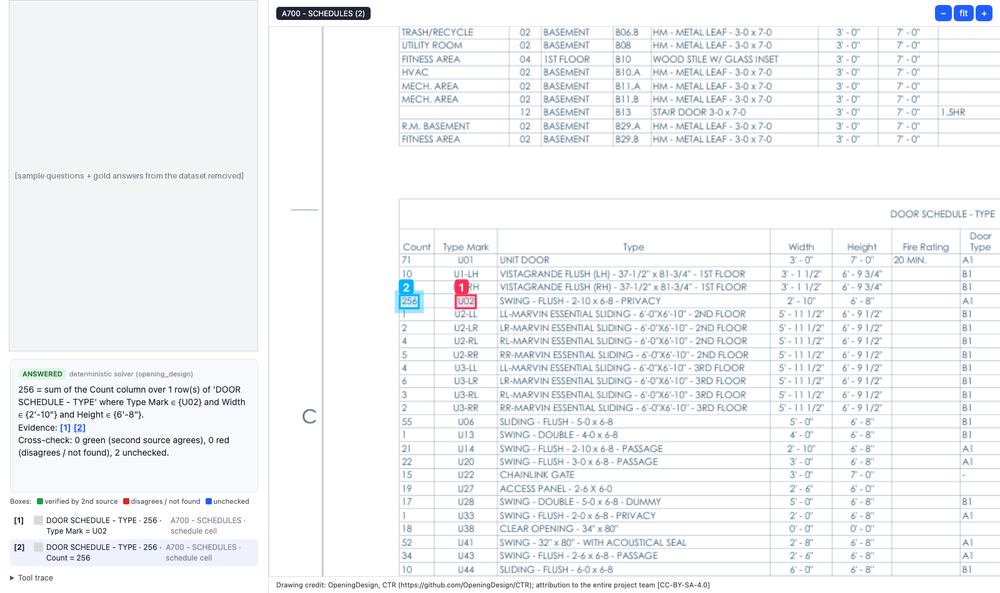
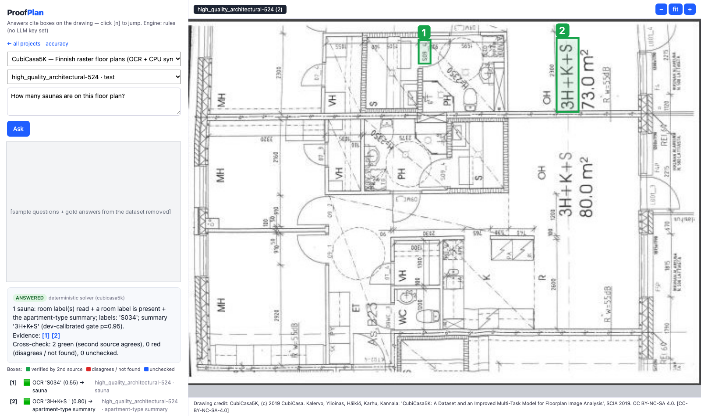

# ProofPlan

**Answers about construction drawings that you can check on the sheet.**
Ask *"How many U02 doors are scheduled?"* or *"What is the net area of apartment B?"* and ProofPlan returns a number,
the numbered boxes on the drawing it came from (`[1] [2] …`, click to zoom), and a cross-check colour:

- 🟩 **green** = a second, independent source agrees (DXF vs PDF fill, IFC model vs rendered plan, room labels vs the apartment-type summary)
- 🟥 **red** = the second source disagrees or the item was not found
- 🟦 **blue** = single source, unchecked

When the evidence is weak it answers **NOT SURE** instead of guessing. Built for Junction 2026 ("Make Blueprints Talk").
Everything below runs on CPU with **no API key**; the measurements are deterministic (PyMuPDF, ezdxf, IfcOpenShell, RapidOCR).


| | |
|---|---|
|  |  |
| Door schedule on a rotated 36×24 sheet: the answer sums the *Count* cell of row U02; both cells are boxed. | Raster plan: the `3H+K+S` summary says one sauna, and an OCR'd `S…` token agrees (here a rotated room tag beside the sauna rather than the big `S` label, a reminder that a box is evidence you can check, not proof). |
|  |  |
| ifc_bench: door types counted from the IFC model; every door is cited by GUID and boxed on the rendered plan. | Honest abstention: three `MH` labels and the `4H+K+S` summary agree on 3 bedrooms, but the dev-calibrated gate is below its threshold, so NOT SURE (boxes stay visible). |

## Results (held-out drawings)

The split is by drawing, never by question: IFC by model, Swiss Dwellings by plan, CubiCasa by image, OpeningDesign by project
(Sports_Complex = dev, CTR = test). Rules were tuned on dev only. **First run** is the first time the held-out split was scored;
where *current* is higher, test errors informed a fix, so treat it as optimistic. Accuracy counts an abstention as wrong;
*acc | answered* is precision when ProofPlan does answer. Scoring follows the challenge: counts exact, areas/lengths/volumes within 2 %.

| family | n (test) | first run | current | acc \| answered | abstain | how |
|---|---|---|---|---|---|---|
| swiss_dwellings / area | 5798 | 99.0 % (n=300) | 99.4 % (phase B first run; was 99.6 %) | 99.97 % (was 99.6 %) | 0.6 % | DXF room polygons minus holes; PDF fill classes exclude outdoor/stairwell; **NOT SURE when the PDF filled-region area differs from the DXF by > 1.5 %** (phase B, BRAINSTORM #5) |
| swiss_dwellings / count | 12364 | 100 % (n=300) | 100 % | 100 % | 0 % | DXF symbols/rooms, checked for ink on the PDF; NOT SURE when extra bathtub drains or an apartment-letter gap suggest a missed symbol/unit (did not fire on test) |
| ifc_models / area | 1490 | 100 % (n=300) | 100 % | 100 % | 0 % | IfcSpace Qto (unit-scaled) or footprint; plan polygon cross-check |
| ifc_models / count | 328 | 90.0 % (n=300) | 100 % | 100 % | 0 % | elements by storey containment; GUID boxes on the plan |
| ifc_models / length | 22 | 100 % | 100 % | 100 % | 0 % | |
| ifc_models / volume | 42 | 100 % | 100 % | 100 % | 0 % | |
| opening_design / count | 17 | 64.7 % | 88.2 % | 93.8 % | 5.9 % | rotated ruled-table extractor; filter + sum Count column |
| opening_design / text | 3 | 33.3 % | 100 % | 100 % | 0 % | lenient match (all digit tokens of the gold must appear) |
| cubicasa5k / count (rooms) | 16186 | 49.2 % (phase 3: 45.8 %, phase 1 rules: 28.5 %) | = | 94.3 % (phase 3: 94.7 %) | 47.8 % (phase 3: 51.6 %) | OCR v2 (upright + rotated passes, weak single letters kept) → FI/SV label lexicon + apartment summary + code identity (KH vs PH, combos) → dev-trained gate per room kind; a PH washroom with no sauna label proposes "1 sauna" (said so); one box per label |
| cubicasa5k / count (storeys) | 4990 | 88.3 % (phase B CP rule; before: 85.2 % @ 95.4 %) | = | 94.0 % | 6.1 % | XY-cut layout split + OCR storey words, dev-trained gate; one box per drawing |
| cubicasa5k / count (WC seats) | 4984 | 46.2 % (phase 1 detector: 28.0 %) | = | 92.4 % (phase 1: 91.3 %) | 50.0 % | CPU symbol detector fused with bathroom/WC room labels, dev-trained gate; detector boxes and/or label boxes; the text says when the count rests on labels |
| cubicasa5k / count (showers/baths) | 4604 | 42.7 % | = | 94.2 % | 54.7 % | **inferred from room labels** (≈ one per bathroom/washroom), not detected; label boxes; ~⅓ of dev answers are the prior "a dwelling has ≥ 1" with the room labels read as boxes, and the answer says so |
| cubicasa5k / count (sinks) | 4930 | 19.1 % | = | 91.8 % | 79.2 % | **inferred from room labels** (kitchen + bathrooms + WCs), not detected; label boxes |
| cubicasa5k / count (doors, windows) | 8656 | 0 % | = | — | 100 % | CPU detectors tried → abstain. Phase E: a classical-CV wall-gap detector (door swing arcs, window glass lines) + gate reached at best 37–46 % right when answering on dev, far below the required 95 % lower bound, so it is **not shipped** (no test run). Needs a trained detector or a VLM |
| ifc_bench / text | 477 | 17.8 % (41.7 % \| ans., 42.8 % answered); phase C first run: 13.8 % (58.9 % \| ans., 23.5 % answered) | 7.3 % (**current, optimistic**: test scored before) | 72.9 % | 89.9 % | IfcOpenShell fact cache + ~40 question templates (no LLM); strict scorer; phase E: every answer is re-derived by a second, independent IFC code path (else NOT SURE); a template answers only if it was right in ≥ 90 % of ≥ 5 dev answers with any dev model or near-copy group left out, and only if it consumes every content word of the question; GUID evidence, boxed on `ifc_models` renders when the model has one |
| **ALL** (every test question) | 64891 | — (families were first-run at different times) | **58.0 %** | 97.0 % | 40.2 % | full run after phase E (only ifc_bench changed): `eval/results_test_all_current.txt`; phase D was 58.1 % / 96.9 % |

OpeningDesign dev (Sports_Complex, tuned on): area 100 % (n=9), count 90.9 % (n=22), text 84.6 % (n=13).
ifc_bench dev (11 models, n=343), phase E: leave-one-model-out out-of-fold **98.0 % when answering** (49/50, 95 % lower bound 90.9 %), 14.6 % answered (phase C: 87.9 % / 36.2 %) — see [eval/ifcb/](eval/ifcb/) and `eval/ifcb_lomo.py`. On test the same method gives 72.9 % (current, optimistic), so the dev number does not transfer.
**Strict mode** (app checkbox, `jeval --strict`): every dev-calibrated gate uses a second threshold whose Clopper–Pearson 95 % lower bound
on dev OOF precision is ≥ 95 % (normal: ≥ 90 %). CubiCasa test first run in strict mode: 26.0 % accuracy, **96.8 % when answering**,
26.9 % answered (normal: 39.7 % / 93.9 % / 42.3 %). Bedroom and balcony counts never answer in strict mode. Vector sources are unaffected.
Per-kind: `eval/cubicasa/test_firstrun_phaseB_strict.txt`.
Per-kind CubiCasa numbers: [eval/cubicasa/NOTES.md](eval/cubicasa/NOTES.md). OpeningDesign notes: [eval/opening/NOTES.md](eval/opening/NOTES.md).
The same table is served at `/api/accuracy` and shown in the app.

**Honest caveats.** Swiss and IFC questions appear to be generated from the same geometry we measure, so near-100 % there shows the
pipeline is faithful, not that it generalises to arbitrary drawings. OpeningDesign has only 20 held-out questions. CubiCasa is the
real raster challenge. Without a neural model ProofPlan answers about half of its room questions (52 %), ~90 % of its storey questions,
half of its WC-seat and shower/bath questions, a fifth of its sink questions, and none of its door or window questions. The gates are small
models fit on dev counts (WC seats also on ~700 hand-labelled dev crops). Their thresholds were chosen out-of-fold on dev; since phase A each τ
is the max-coverage threshold whose Clopper–Pearson 95 % lower bound on dev precision is ≥ 90 %. Test was scored once per method
(phase A first run: commit 6f44962, `eval/cubicasa/test_firstrun_phaseA.txt`; phase B, storey gate moved to the same rule: commit 93a0afe,
`eval/cubicasa/test_firstrun_phaseB.txt`). Fixture caveat: showers/baths and sinks are **counted from room
labels, not from fixture symbols**. A bathroom label is taken as about one shower or tub. It works on dev/test because most flats are
simple, but it is a statistical inference, and every such answer says "inferred from room labels; the fixture symbols themselves were not
detected" and boxes the labels it used. On test the separate-WC room kind came out at 89.7 % when answering, just under 90 %. Room-count caveats:
- Gold kitchens are 1 on 98 % of plans, so kitchen precision (97.8 %) mostly says "a kitchen label was read", not that counting is hard.
  The gate never answers from the prior alone: every answer needs a label, the summary, or (for 0) other room labels read on the plan.
- Answers of 0 (no sauna / no separate WC / no balcony) rest on absence: other room labels were read and none is of that kind.
  That is weaker evidence than a label, and the gate learned on dev when it holds (WC 90.4 %, sauna 91.8 % on test).
- Saunas drawn only as a bench, without a text label, are invisible to this method; 2 images where RapidOCR crashes on the rotated
  passes fall back to the upright OCR.
- The gate is a black box over ~35 count/confidence/layout features, so it sometimes abstains on cases a human finds easy
  (labels and summary agreeing, screenshot 14).

**ifc_bench** gold answers are long LLM-written reports, so they are scored with a stricter rule than the other text families
(`eval/ifcb_score.py`): every number in the gold must appear in our answer at the gold's precision, every code token (2A12, IFC2X3)
must appear whole, and a "not available" gold needs a negative answer. Dev precision (84 %) did not carry over to the held-out models
(42 % first run): on test the questions are more varied (orientation and building-part qualifiers) and templates matched
questions broader than they could answer. The scope guards added after that run raise precision to 47.5 % but are test-informed.
Phase C replaced the hand-set gate with a **leave-one-model-out gate** fitted on dev: a template answers only if it matched the gold in
≥ 75 % of ≥ 3 dev answers, and still does with any one dev model left out. It also added a **strict parser**: a word of the question
that the template does not understand ("above", "volume" for the load-bearing template) means NOT SURE, and the answer names the word.
New test first run: **58.9 % when answering** (was 41.7 %), at 23.5 % answered (was 42.8 %). Accuracy fell from 17.8 % to 13.8 %.
Phase E added **answer self-checks** (each number and grouping re-derived by an independent walk of the IFC graph; ambiguous "type"
groupings, mislabelled storeys and type-name fire ratings that contradict the properties mean NOT SURE) and raised the gate to ≥ 90 % of ≥ 5
dev answers. Dev out-of-fold: 98.0 % when answering. Test, run once more and labelled **current (optimistic)** because this test set had
been scored before: **72.9 % when answering** (35/48), 10.1 % answered, 7.3 % accuracy. The ≥ 90 % target is **not met** on test.

### What "100 %" honestly means

ProofPlan aims at 100 % **precision**, not 100 % coverage. When it answers, the number comes with boxes on the drawing and, where
possible, a second independent source that agrees. When the evidence doesn't hold up, it says NOT SURE.
On vector drawings (Swiss DXF/PDF, IFC) that already means ≥ 99.9 % right when it answers (Swiss area 99.97 %, all else 100 %). On raster scans
without a neural detector it means ~94 % right on the ~42 % of questions it chooses to answer, and the rest are honest abstentions, not guesses.
Coverage goes up only when a new independent signal (a label, a summary, a symbol) passes a threshold fixed on dev before the
held-out drawings are scored once. That is why our "100 %" claim is about answers you can check, not about pretending every
question is answerable.
*Exception:* free-text ifc_bench questions are only 72.9 % right when answered on test (phase E, optimistic), so the claim does not cover them.

### What changed in phase E (Sat 14 Nov evening)

| item | target | result |
|---|---|---|
| E1 CubiCasa doors/windows, classical CV (wall gaps, swing arcs, window lines) + gate | dev OOF Clopper–Pearson 95 % lower bound ≥ 95 % | **not met → not shipped.** Best dev OOF: doors 37 % right at 3.7 % answered, windows 46 % at 1.2 %. Where two independent door detectors agree, only 33 % match the gold. Doors/windows still abstain; no test run. Code kept disabled: `bp/sources/cubi_open.py`, `scripts/cubi/train_open.py`, `eval/cubicasa/train_open_dev_oof.txt` |
| E2 ifc_bench precision: self-checks + stricter leave-one-model-out gate | ≥ 90 % when answering | dev OOF 98.0 % (LB 90.9 %); **test 72.9 % (current, optimistic) — not met**; was 58.9 %. Answered 23.5 % → 10.1 %, accuracy 13.8 % → 7.3 % |
| full test run | no regressions | ALL 58.1 % / 96.9 % → 58.0 % / 97.0 %; every other family unchanged |

### What changed overnight (Sat 14 Nov, phases A–D)

Before = full test run at commit a0ffb88 (`eval/results_test_all_before_overnight.txt`). After = the first (and only) test run of
each new method, re-confirmed unchanged by the final phase D run. Nothing was tuned on test.

| family | before: acc / when answering / answered | after: acc / when answering / answered | what changed |
|---|---|---|---|
| CubiCasa (all kinds, 44,350 q) | 29.5 % / 94.6 % / 31.1 % | **39.7 % / 93.9 % / 42.3 %** | showers/baths and sinks inferred from room labels (said so in the answer); WC seats = detector + labels; room gate learns code identity and "washroom → sauna"; Clopper–Pearson thresholds |
| · showers/baths | 0 % / — / 0 % | 42.7 % / 94.2 % / 45.3 % | new (from bathroom labels) |
| · sinks | 0 % / — / 0 % | 19.1 % / 91.8 % / 20.8 % | new (from kitchen/bath/WC labels) |
| · WC seats | 28.0 % / 91.3 % / 30.6 % | 46.2 % / 92.4 % / 50.0 % | detector fused with room labels |
| · rooms (6 kinds) | 45.8 % / 94.7 % / 48.4 % | 49.2 % / 94.3 % / 52.2 % | sauna 33.7 → 45.0 %, balcony 40.2 → 46.1 % |
| · storeys | 85.2 % / 95.4 % / 89.3 % | 88.3 % / 94.0 % / 93.9 % | threshold now from a 95 % lower bound on dev |
| · doors, windows | 0 % | 0 % | still abstain (no detector) |
| Swiss Dwellings (18,162 q) | 99.87 % right when answering, 24 wrong | **99.98 %, 4 wrong**, 0.18 % abstain | NOT SURE when DXF and PDF fill areas disagree, extra bathtub drains, apartment-letter gaps |
| ifc_bench (477 q) | 17.8 % / 41.7 % / 42.8 % (first run) | 13.8 % / **58.9 %** / 23.5 % | leave-one-model-out template gate + "every word understood" parser; fuller answers |
| IFC models, OpeningDesign | unchanged | unchanged | — |
| **ALL (64,891 q)** | 51.1 % / 97.4 % / 52.5 % | **58.1 % / 96.9 % / 59.9 %** | overall precision is 0.5 pt lower only because many more ~94 % CubiCasa answers enter the mix |

New: **strict mode** (app checkbox): CubiCasa 26.0 % / 96.8 % / 26.9 %. Not shipped: the IFC cross-check abstain (no dev errors to catch),
a neural detector for doors/windows (training-set leakage risk), extra OCR passes and a touching-storeys detector (no time).
Short of target: ifc_bench precision 58.9 % (target ≥ 60 %); separate-WC room 89.7 % and strict-mode bathroom 94.4 % on test, just under
their 90 % / 95 % dev bounds.

## Run (fresh clone)

```bash
git clone <this repo> proofplan && cd proofplan
python3 -m venv .venv && . .venv/bin/activate && pip install -r requirements.txt
python -m pytest -q tests                           # works without the dataset: dataset-dependent tests skip

# everything below needs the Junction 2026 dataset (not included, see DATA.md)
export BP_JDATA=/path/to/junction_data              # folder with questions.jsonl and data/<source>/ (default: ./data/jdata)
uvicorn app.server:app --host 127.0.0.1 --port 8765 # http://localhost:8765
python eval/jeval.py --split test --n 100000        # all families, held-out
python eval/cubi_eval.py --split dev                # CubiCasa per kind (use dev for tuning!)
python eval/ifcb_eval.py --split dev                # ifc_bench, strict scorer
python eval/build_accuracy.py                       # -> eval/accuracy.json (UI panel)
```

Caches (OCR tokens, IFC facts, rendered pages) are written to `data/jcache/` on first use (git-ignored); the first CubiCasa answer
on an image takes about 1 s for OCR. Optional, to warm or retrain:

```bash
python scripts/cubi/ocr_all.py --v2 --shard 0/5     # (x5, BP_ORT_THREADS=2) warm OCR v2
python scripts/cubi/train_rooms.py 0.92             # room gates on dev (out-of-fold thresholds) -> bp/models/cubi_rooms.pkl
playwright install chromium && python scripts/shot_proofplan.py   # screenshots -> shots/
```

Optional VLM for raster symbols: `BP_VLM=anthropic|openai|xai` plus `ANTHROPIC_API_KEY` / `OPENAI_API_KEY` / `XAI_API_KEY`.
The VLM must return JSON boxes; it is asked twice and ProofPlan abstains unless both counts agree (`bp/sources/vlm.py`, not yet evaluated).

### 3D evidence view

On an IFC question (for example *"How many doors are shown on the floor plan of 'E00_OKRD'?"*), a **3D** tab appears next to the plan.
The building is tessellated once on the CPU with IfcOpenShell (`app/ifc3d.py`, cached under `data/jcache/ifc3d/`) and shown with vendored [three.js](https://threejs.org/) (MIT, no CDN).
Cited elements (the 26 doors, say) are highlighted; everything else is a grey, semi-transparent context. Click an element to see its IFC class, name, GlobalId and the quantity used in the answer, or use **Fit to highlighted**.
This does not change any answer, gate or accuracy number. `GET /api/ifc3d?path=…&highlight=<GlobalId>`.


## How it works

```
bp/jsolve.py            dispatch by source -> {status, answer, value, evidence[{bbox|poly, page, text, kind, guid, verified}]}
bp/sources/swiss.py     Swiss Dwellings: DXF measures, vector PDF checks (affine DXF->PDF map, fill classes)
bp/sources/ifcsrc.py    IFC: IfcOpenShell quantities/containment; rendered SVG/PDF plan checks by GUID
bp/sources/schedtab.py  generic ruled-table extractor for rotated sheets (text direction -> reading frame,
                        merged rules -> rows/columns, multi-line and spanning headers)
bp/sources/opening.py   schedule QA: pick schedule, parse filters (type marks, sizes, id ranges, descriptions),
                        count rows or sum the Count column, lookups, superlatives; abstains on plan-view counts
bp/sources/cubicasa.py  CubiCasa entry point: OCR (v1 upright, v2 with 90/270 passes), storey + symbol answers
bp/sources/cubi_rooms.py  room labels: FI/SV lexicon, combo labels (KH/WC, OH+KK), summary parser, de-dup, dev-trained gate
bp/sources/ifcb_facts.py  ifc_bench: one-pass IfcOpenShell extraction (psets, quantities, materials, types, storeys) -> cached pickle
bp/sources/ifcbench.py  ifc_bench: intent routing -> template handlers; unit normalisation; LOMO gate (ifcb_gate.json); GUID evidence + plan boxes
bp/sources/ifcb_parse.py  ifc_bench: strict parser, every content word of the question must be consumed by the template
bp/sources/vlm.py       key-pluggable grounded VLM (two-pass agreement)
app/                    FastAPI server + single-page UI (project picker, viewer, evidence list, accuracy panel)
eval/                   held-out split (eval/jeval.py: split_of), scorers, result tables
```

## Data & licences

**No dataset files are redistributed here** — no drawings, no questions, no gold answers. How to get the data and set
`BP_JDATA`: [DATA.md](DATA.md). The drawings are **not** in this repository. They come from the Junction 2026 challenge dataset, which is distributed
*for non-commercial use in the Junction challenge*; each source keeps its own licence, and the app shows the credit line
from `data/<source>/LICENSE.md` under every drawing.

| source | licence | credit |
|---|---|---|
| Swiss Dwellings | CC BY 4.0 | Swiss Dwellings v3.0.0 by M. Standfest, M. Franzen, Y. Schröder, L. Gonzalez Medina, Y. Villanueva Hernandez, J. H. Buck, Y.-L. Tan, M. Niedzwiecka, R. Colmegna (Archilyse AG), doi:10.5281/zenodo.7788422. Plans drawn by the Junction dataset builders from that geometry (derived work). |
| IFC models | per model | CC BY 4.0: BIM-SPEED demo projects (Garcia & Hartmann 2022, TU Berlin, doi:10.14279/depositonce-16441.2); Real-World Escape Route Test Model (Fischer et al. 2023, TU Wien, doi:10.48436/2heb4-xqb83); Esplan, Molio Demo-hus, Gymzaal Amersfoort via buildingSMART Community Sample-Test-Files. MIT: DigitalHub (© 2020 RWTH Aachen E3D), ResBIM (© 2025 Xing Liang), buildingSMART Community Projects. KIT IFC examples (IAI/KIT, unrestricted use). Duplex and Medical-Dental Clinic (buildingSMART, CC BY-ND 3.0) are used unchanged and **never rendered**. |
| OpeningDesign | CC BY-SA 4.0 (MIT for 104_Janesville, Schultz_Residence) | OpeningDesign, Madison WI (github.com/OpeningDesign) — Sports_Complex and CTR (Cannery Trail Residences); attribution to the entire project team. |
| CubiCasa5K | CC BY-NC-SA 4.0 (non-commercial) | © 2019 CubiCasa. Kalervo, Ylioinas, Häikiö, Karhu, Kannala: "CubiCasa5K: A Dataset and an Improved Multi-Task Model for Floorplan Image Analysis", SCIA 2019. |

Screenshots in `shots/` show excerpts of these drawings with their credit line; screenshots of CubiCasa (NC-SA) and
OpeningDesign (SA) are shared under those same licences. In each screenshot the app's list of sample questions and gold answers
(read from the dataset at runtime) has been blanked out; only the one question being asked is visible.

**Code:** GNU AGPL-3.0 ([LICENSE](LICENSE)), because the app links PyMuPDF (AGPL-3.0).
**Exception:** the dev-trained CubiCasa gates in `bp/models/*.pkl` and the hand-made symbol labels in `scripts/cubi/seed_labels.json`
are derived from CubiCasa5K and are shared under **CC BY-NC-SA 4.0** (see [bp/models/LICENSE.md](bp/models/LICENSE.md)).
Without them the CubiCasa solver falls back to its older rules (lower coverage); the other families do not use them.

Only aggregate scores are published (`eval/accuracy.json`, `eval/**/*.txt`); per-question result files are not.

Libraries: PyMuPDF (AGPL-3.0 / commercial), IfcOpenShell (LGPL-3.0), ezdxf (MIT), shapely (BSD), RapidOCR (Apache-2.0), FastAPI (MIT).
