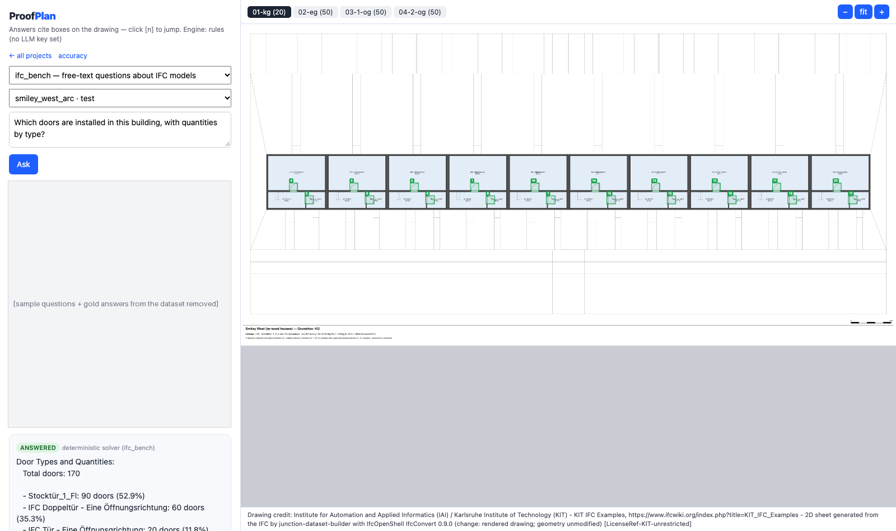
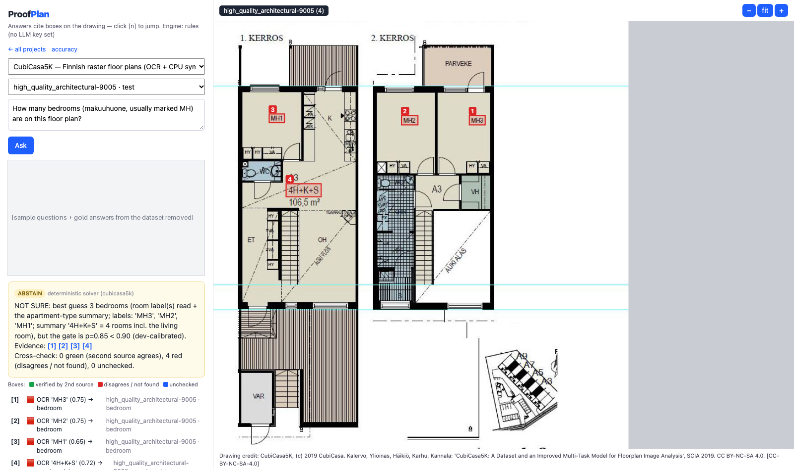

# ProofPlan

**Answers about construction drawings that you can check on the sheet.**
Ask *"How many U02 doors are scheduled?"* or *"What is the net area of apartment B?"* and ProofPlan returns a number,
the numbered boxes on the drawing it came from (`[1] [2] …`, click to zoom), and a cross-check colour:

- 🟩 **green** = a second, independent source agrees (DXF vs PDF fill, IFC model vs rendered plan, room labels vs the apartment-type summary)
- 🟥 **red** = the second source disagrees or the item was not found
- 🟦 **blue** = single source, unchecked

When the evidence is weak it answers **NOT SURE** instead of guessing. Built for Junction 2026 ("Make Blueprints Talk").
Everything below runs on CPU with **no API key**; the measurements are deterministic (PyMuPDF, ezdxf, IfcOpenShell, RapidOCR).


| | |
|---|---|
|  |  |
| Door schedule on a rotated 36×24 sheet: the answer sums the *Count* cell of row U02; both cells are boxed. | Raster plan: the `3H+K+S` summary says one sauna, and an OCR'd `S…` token agrees (here a rotated room tag beside the sauna rather than the big `S` label, a reminder that a box is evidence you can check, not proof). |
|  |  |
| ifc_bench: door types counted from the IFC model; every door is cited by GUID and boxed on the rendered plan. | Honest abstention: three `MH` labels and the `4H+K+S` summary agree on 3 bedrooms, but the dev-calibrated gate is below its threshold, so NOT SURE (boxes stay visible). |

## Results (held-out drawings)

The split is by drawing, never by question: IFC by model, Swiss Dwellings by plan, CubiCasa by image, OpeningDesign by project
(Sports_Complex = dev, CTR = test). Rules were tuned on dev only. **First run** is the first time the held-out split was scored;
where *current* is higher, test errors informed a fix, so treat it as optimistic. Accuracy counts an abstention as wrong;
*acc | answered* is precision when ProofPlan does answer. Scoring follows the challenge: counts exact, areas/lengths/volumes within 2 %.

| family | n (test) | first run | current | acc \| answered | abstain | how |
|---|---|---|---|---|---|---|
| swiss_dwellings / area | 5798 | 99.0 % (n=300) | 99.6 % | 99.6 % | 0 % | DXF room polygons minus holes; PDF fill classes exclude outdoor/stairwell |
| swiss_dwellings / count | 12364 | 100 % (n=300) | 100 % | 100 % | 0 % | DXF symbols/rooms, checked for ink on the PDF |
| ifc_models / area | 1490 | 100 % (n=300) | 100 % | 100 % | 0 % | IfcSpace Qto (unit-scaled) or footprint; plan polygon cross-check |
| ifc_models / count | 328 | 90.0 % (n=300) | 100 % | 100 % | 0 % | elements by storey containment; GUID boxes on the plan |
| ifc_models / length | 22 | 100 % | 100 % | 100 % | 0 % | |
| ifc_models / volume | 42 | 100 % | 100 % | 100 % | 0 % | |
| opening_design / count | 17 | 64.7 % | 88.2 % | 93.8 % | 5.9 % | rotated ruled-table extractor; filter + sum Count column |
| opening_design / text | 3 | 33.3 % | 100 % | 100 % | 0 % | lenient match (all digit tokens of the gold must appear) |
| cubicasa5k / count (rooms) | 16186 | 45.8 % (phase 1 rules: 28.5 %) | = | 94.7 % (phase 1: 89.6 %) | 51.6 % (phase 1: 68.3 %) | OCR v2 (upright + rotated passes, weak single letters kept) → FI/SV label lexicon + apartment summary → dev-trained gate per room kind; one box per label |
| cubicasa5k / count (storeys) | 4990 | 85.2 % | = | 95.4 % | 10.7 % | XY-cut layout split + OCR storey words, dev-trained gate; one box per drawing |
| cubicasa5k / count (WC seats) | 4984 | 28.0 % | = | 91.3 % | 69.4 % | CPU closed-shape symbol classifier + count gate (dev-trained); one box per seat |
| cubicasa5k / count (doors, windows, sinks, showers) | 18190 | 0 % | = | — | 100 % | CPU detectors tried (≤ 17 % exact on dev) → abstain; needs a trained detector or a VLM |
| ifc_bench / text | 477 | 17.8 % (41.7 % \| ans., 42.8 % answered) | 18.0 % | 47.5 % | 62.1 % | IfcOpenShell fact cache + ~40 question templates (no LLM); strict scorer; templates < 60 % on dev withheld; GUID evidence, boxed on `ifc_models` renders when the model has one |

OpeningDesign dev (Sports_Complex, tuned on): area 100 % (n=9), count 90.9 % (n=22), text 84.6 % (n=13).
ifc_bench dev (11 models, tuned on): 50.1 % overall, 83.9 % when answering, 59.8 % answered (n=343) — see [eval/ifcb/](eval/ifcb/).
Per-kind CubiCasa numbers: [eval/cubicasa/NOTES.md](eval/cubicasa/NOTES.md). OpeningDesign notes: [eval/opening/NOTES.md](eval/opening/NOTES.md).
The same table is served at `/api/accuracy` and shown in the app.

**Honest caveats.** Swiss and IFC questions appear to be generated from the same geometry we measure, so near-100 % there shows the
pipeline is faithful, not that it generalises to arbitrary drawings. OpeningDesign has only 20 held-out questions. CubiCasa is the
real raster challenge. Without a neural model ProofPlan answers about half of its room questions (48 %), ~90 % of its storey questions,
~30 % of its WC-seat questions, and none of its door, window, sink or shower questions. The room, storey and WC-seat gates are small
models fit on dev counts (WC seats also on ~700 hand-labelled dev crops); their thresholds were chosen out-of-fold on dev, and test
was scored once per method. Room-count caveats:
- Gold kitchens are 1 on 98 % of plans, so kitchen precision (97.8 %) mostly says "a kitchen label was read", not that counting is hard.
  The gate never answers from the prior alone: every answer needs a label, the summary, or (for 0) other room labels read on the plan.
- Answers of 0 (no sauna / no separate WC / no balcony) rest on absence: other room labels were read and none is of that kind.
  That is weaker evidence than a label, and the gate learned on dev when it holds (WC 90.4 %, sauna 91.8 % on test).
- Saunas drawn only as a bench, without a text label, are invisible to this method; 2 images where RapidOCR crashes on the rotated
  passes fall back to the upright OCR.
- The gate is a black box over ~35 count/confidence/layout features, so it sometimes abstains on cases a human finds easy
  (labels and summary agreeing, screenshot 14).

**ifc_bench** gold answers are long LLM-written reports, so they are scored with a stricter rule than the other text families
(`eval/ifcb_score.py`): every number in the gold must appear in our answer at the gold's precision, every code token (2A12, IFC2X3)
must appear whole, and a "not available" gold needs a negative answer. Dev precision (84 %) did not carry over to the held-out models
(42 % first run): on test the questions are more varied (orientation and building-part qualifiers) and templates matched
questions broader than they could answer. The scope guards added after that run raise precision to 47.5 % but are test-informed.

## Run (fresh clone)

```bash
git clone <this repo> proofplan && cd proofplan
python3 -m venv .venv && . .venv/bin/activate && pip install -r requirements.txt
python -m pytest -q tests                           # works without the dataset: dataset-dependent tests skip

# everything below needs the Junction 2026 dataset (not included, see DATA.md)
export BP_JDATA=/path/to/junction_data              # folder with questions.jsonl and data/<source>/ (default: ./data/jdata)
uvicorn app.server:app --host 127.0.0.1 --port 8765 # http://localhost:8765
python eval/jeval.py --split test --n 100000        # all families, held-out
python eval/cubi_eval.py --split dev                # CubiCasa per kind (use dev for tuning!)
python eval/ifcb_eval.py --split dev                # ifc_bench, strict scorer
python eval/build_accuracy.py                       # -> eval/accuracy.json (UI panel)
```

Caches (OCR tokens, IFC facts, rendered pages) are written to `data/jcache/` on first use (git-ignored); the first CubiCasa answer
on an image takes about 1 s for OCR. Optional, to warm or retrain:

```bash
python scripts/cubi/ocr_all.py --v2 --shard 0/5     # (x5, BP_ORT_THREADS=2) warm OCR v2
python scripts/cubi/train_rooms.py 0.92             # room gates on dev (out-of-fold thresholds) -> bp/models/cubi_rooms.pkl
playwright install chromium && python scripts/shot_proofplan.py   # screenshots -> shots/
```

Optional VLM for raster symbols: `BP_VLM=anthropic|openai|xai` plus `ANTHROPIC_API_KEY` / `OPENAI_API_KEY` / `XAI_API_KEY`.
The VLM must return JSON boxes; it is asked twice and ProofPlan abstains unless both counts agree (`bp/sources/vlm.py`, not yet evaluated).

## How it works

```
bp/jsolve.py            dispatch by source -> {status, answer, value, evidence[{bbox|poly, page, text, kind, guid, verified}]}
bp/sources/swiss.py     Swiss Dwellings: DXF measures, vector PDF checks (affine DXF->PDF map, fill classes)
bp/sources/ifcsrc.py    IFC: IfcOpenShell quantities/containment; rendered SVG/PDF plan checks by GUID
bp/sources/schedtab.py  generic ruled-table extractor for rotated sheets (text direction -> reading frame,
                        merged rules -> rows/columns, multi-line and spanning headers)
bp/sources/opening.py   schedule QA: pick schedule, parse filters (type marks, sizes, id ranges, descriptions),
                        count rows or sum the Count column, lookups, superlatives; abstains on plan-view counts
bp/sources/cubicasa.py  CubiCasa entry point: OCR (v1 upright, v2 with 90/270 passes), storey + symbol answers
bp/sources/cubi_rooms.py  room labels: FI/SV lexicon, combo labels (KH/WC, OH+KK), summary parser, de-dup, dev-trained gate
bp/sources/ifcb_facts.py  ifc_bench: one-pass IfcOpenShell extraction (psets, quantities, materials, types, storeys) -> cached pickle
bp/sources/ifcbench.py  ifc_bench: intent routing -> template handlers; unit normalisation; dev-tuned gate; GUID evidence + plan boxes
bp/sources/vlm.py       key-pluggable grounded VLM (two-pass agreement)
app/                    FastAPI server + single-page UI (project picker, viewer, evidence list, accuracy panel)
eval/                   held-out split (eval/jeval.py: split_of), scorers, result tables
```

## Data & licences

**No dataset files are redistributed here** — no drawings, no questions, no gold answers. How to get the data and set
`BP_JDATA`: [DATA.md](DATA.md). The drawings are **not** in this repository. They come from the Junction 2026 challenge dataset, which is distributed
*for non-commercial use in the Junction challenge*; each source keeps its own licence, and the app shows the credit line
from `data/<source>/LICENSE.md` under every drawing.

| source | licence | credit |
|---|---|---|
| Swiss Dwellings | CC BY 4.0 | Swiss Dwellings v3.0.0 by M. Standfest, M. Franzen, Y. Schröder, L. Gonzalez Medina, Y. Villanueva Hernandez, J. H. Buck, Y.-L. Tan, M. Niedzwiecka, R. Colmegna (Archilyse AG), doi:10.5281/zenodo.7788422. Plans drawn by the Junction dataset builders from that geometry (derived work). |
| IFC models | per model | CC BY 4.0: BIM-SPEED demo projects (Garcia & Hartmann 2022, TU Berlin, doi:10.14279/depositonce-16441.2); Real-World Escape Route Test Model (Fischer et al. 2023, TU Wien, doi:10.48436/2heb4-xqb83); Esplan, Molio Demo-hus, Gymzaal Amersfoort via buildingSMART Community Sample-Test-Files. MIT: DigitalHub (© 2020 RWTH Aachen E3D), ResBIM (© 2025 Xing Liang), buildingSMART Community Projects. KIT IFC examples (IAI/KIT, unrestricted use). Duplex and Medical-Dental Clinic (buildingSMART, CC BY-ND 3.0) are used unchanged and **never rendered**. |
| OpeningDesign | CC BY-SA 4.0 (MIT for 104_Janesville, Schultz_Residence) | OpeningDesign, Madison WI (github.com/OpeningDesign) — Sports_Complex and CTR (Cannery Trail Residences); attribution to the entire project team. |
| CubiCasa5K | CC BY-NC-SA 4.0 (non-commercial) | © 2019 CubiCasa. Kalervo, Ylioinas, Häikiö, Karhu, Kannala: "CubiCasa5K: A Dataset and an Improved Multi-Task Model for Floorplan Image Analysis", SCIA 2019. |

Screenshots in `shots/` show excerpts of these drawings with their credit line; screenshots of CubiCasa (NC-SA) and
OpeningDesign (SA) are shared under those same licences. In each screenshot the app's list of sample questions and gold answers
(read from the dataset at runtime) has been blanked out; only the one question being asked is visible.

**Code:** GNU AGPL-3.0 ([LICENSE](LICENSE)), because the app links PyMuPDF (AGPL-3.0).
**Exception:** the dev-trained CubiCasa gates in `bp/models/*.pkl` and the hand-made symbol labels in `scripts/cubi/seed_labels.json`
are derived from CubiCasa5K and are shared under **CC BY-NC-SA 4.0** (see [bp/models/LICENSE.md](bp/models/LICENSE.md)).
Without them the CubiCasa solver falls back to its older rules (lower coverage); the other families do not use them.

Only aggregate scores are published (`eval/accuracy.json`, `eval/**/*.txt`); per-question result files are not.

Libraries: PyMuPDF (AGPL-3.0 / commercial), IfcOpenShell (LGPL-3.0), ezdxf (MIT), shapely (BSD), RapidOCR (Apache-2.0), FastAPI (MIT).
